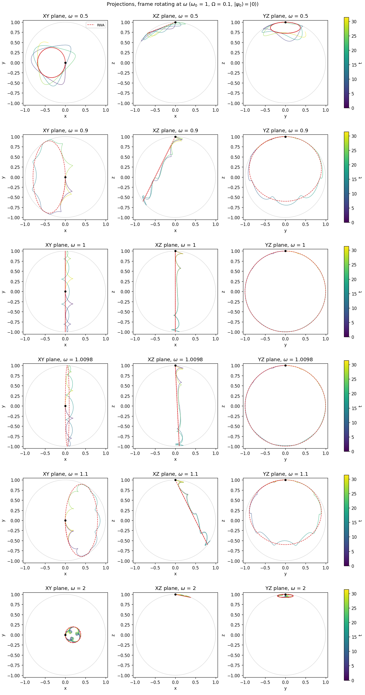
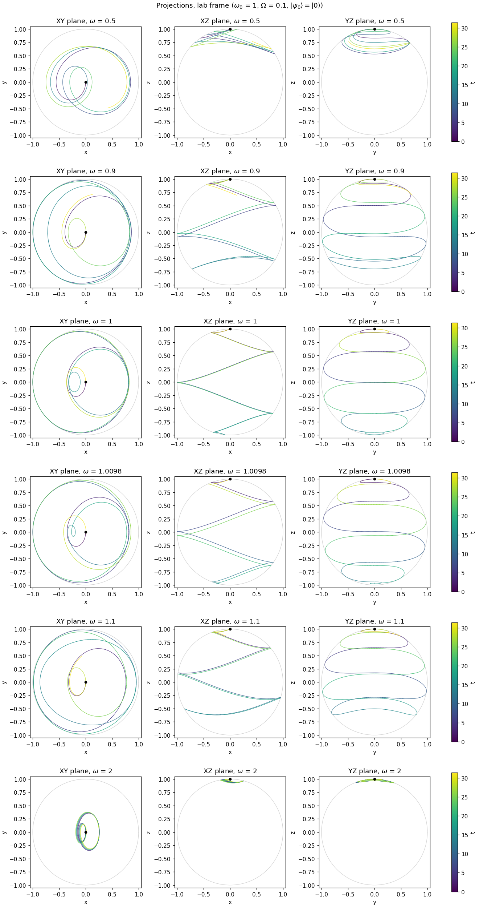
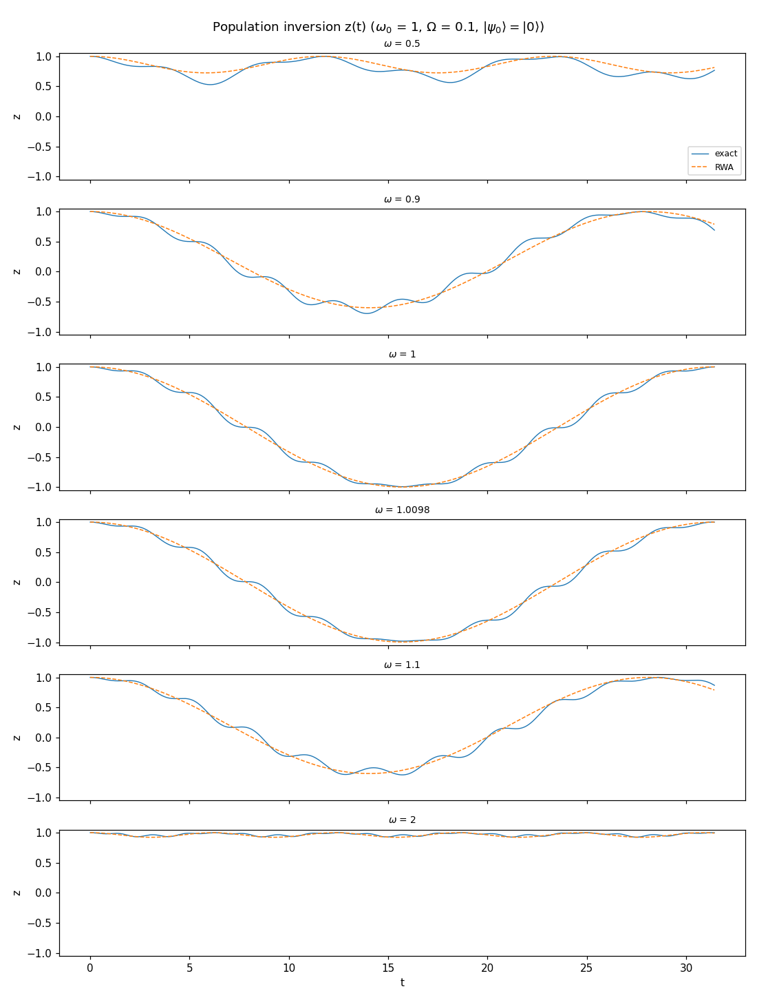
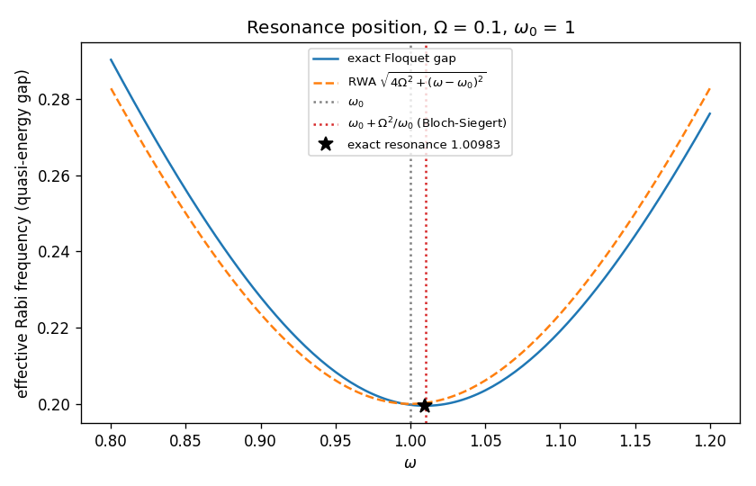

# Driven two-level system beyond the RWA: notes on `task.py`

These notes accompany [task.py](./task.py). Part 1 explains the physics that
the program simulates and tests; Part 2 walks through the code, pointing out
the non-obvious choices and tricks.

Units: $\hbar = 1$ throughout, so energies and angular frequencies are the
same thing. Default parameters of the program: $\varepsilon_0 = 0$,
$\varepsilon_1 = 1$, $\Omega = 0.1$, initial state $\lvert 0\rangle$.

---

## Part 1 — The physics

### 1.1 The Hamiltonian

$$
H(t) = \varepsilon_0 \lvert 0\rangle\langle 0\rvert
     + \varepsilon_1 \lvert 1\rangle\langle 1\rvert
     + 2\Omega\cos(\omega t)\,\bigl(\lvert 0\rangle\langle 1\rvert + \lvert 1\rangle\langle 0\rvert\bigr).
$$

With the Pauli matrices in the basis $(\lvert 0\rangle, \lvert 1\rangle)$ and
$\omega_0 \equiv \varepsilon_1 - \varepsilon_0$ (bare transition frequency):

$$
H(t) = \frac{\varepsilon_0 + \varepsilon_1}{2}\,\mathbb 1
     - \frac{\omega_0}{2}\,\sigma_z
     + 2\Omega\cos(\omega t)\,\sigma_x
     = \frac{\varepsilon_0 + \varepsilon_1}{2}\,\mathbb 1 + \frac12\,\mathbf B(t)\cdot\boldsymbol\sigma ,
$$

$$
\mathbf B(t) = \bigl(4\Omega\cos\omega t,\; 0,\; -\omega_0\bigr).
$$

The identity term multiplies the state by a global phase
$e^{-i(\varepsilon_0+\varepsilon_1)t/2}$ and has no observable effect: only
$\omega_0$, $\Omega$ and $\omega$ matter. The program checks this
(`test_global_energy_shift_invariance`).

Note the sign: $\lvert 0\rangle$ is the **lower** level when
$\varepsilon_1 > \varepsilon_0$, and it sits at the **north** pole of the Bloch
sphere ($\sigma_z\lvert 0\rangle = +\lvert 0\rangle$). The static field
therefore points to the south ($B_z = -\omega_0$).

### 1.2 Bloch vector and Bloch equation

For $\lvert\psi\rangle = c_0\lvert 0\rangle + c_1\lvert 1\rangle$ the Bloch
vector is $\mathbf r = \langle\boldsymbol\sigma\rangle$:

$$
x = 2\,\mathrm{Re}(c_0^* c_1),\qquad
y = 2\,\mathrm{Im}(c_0^* c_1),\qquad
z = \lvert c_0\rvert^2 - \lvert c_1\rvert^2 .
$$

$z = +1$ means "all population in $\lvert 0\rangle$" and $z=-1$ means "all in
$\lvert 1\rangle$". So $P_1 = (1-z)/2$.

From the Heisenberg equation
$\dot\sigma_j = i[H,\sigma_j]$ and $[\sigma_k,\sigma_j] = 2i\epsilon_{kjl}\sigma_l$:

$$
\boxed{\;\dot{\mathbf r} = \mathbf B(t)\times\mathbf r\;}
$$

This is the equation of a classical magnetic moment in a field $\mathbf B$. Two
consequences shape every figure:

* $\frac{d}{dt}\lvert\mathbf r\rvert^2 = 2\,\mathbf r\cdot(\mathbf B\times\mathbf r) = 0$.
  A pure state under unitary evolution stays **on the unit sphere**. All the
  geometry is a curve on $S^2$, and every projection stays inside the unit
  disc.
* At each instant the motion is an infinitesimal rotation about
  $\mathbf B(t)$, at angular speed $\lvert\mathbf B(t)\rvert$.

Without drive ($\Omega = 0$), $\mathbf B = -\omega_0\hat z$ and the vector
precesses about $z$ at $\omega_0$. Because $\mathbf B$ points down, the
precession is **clockwise** seen from $+z$:
$x = \cos\omega_0 t$, $y = -\sin\omega_0 t$ when starting from $(1,0,0)$
(`test_free_precession`).

### 1.3 A linear drive is two circular drives

The drive field is linear along $x$. Write it as the sum of two counter-rotating circular components:

$$
4\Omega\cos\omega t\;\hat x
= \underbrace{2\Omega(\cos\omega t,\,-\sin\omega t,\,0)}_{\text{co-rotating (clockwise)}} +
  \underbrace{2\Omega(\cos\omega t,\,+\sin\omega t,\,0)}_{\text{counter-rotating}} .
$$

* The **co-rotating** component turns in the same sense as the free
  precession. Seen by the spin, it is detuned only by $\Delta = \omega_0 - \omega$,
  so it is nearly resonant when $\omega\approx\omega_0$.
* The **counter-rotating** component turns the other way. Its relative
  frequency is $\omega + \omega_0 \approx 2\omega_0$, which is far off resonance.

The rotating-wave approximation (RWA) keeps the first component and drops the
second. Everything "beyond RWA" in the program comes from the second.

### 1.4 Rotating frame and the RWA: a circle

Go to a frame rotating clockwise about $z$ at the drive frequency $\omega$.
For the in-plane components (using $w = x + iy$) this means
$w' = w\,e^{i\omega t}$, while $z' = z$. Differentiating
$\mathbf r' = R_z(\omega t)\,\mathbf r$ gives again a Bloch equation, with field

$$
\mathbf B'(t) = R_z(\omega t)\,\mathbf B(t) + \omega\hat z .
$$

The extra $\omega\hat z$ is the "fictitious field" of the rotating frame (the
Larmor theorem). Explicitly:

$$
\mathbf B'(t) = \underbrace{(2\Omega,\;0,\;-\Delta)}_{\mathbf B_\text{eff}\ \text{(static)}}
              \;+\; \underbrace{2\Omega(\cos 2\omega t,\;\sin 2\omega t,\;0)}_{\text{counter-rotating, now at }2\omega} .
$$

**RWA** means dropping the fast term. Then $\mathbf B'$ is static and the
solution is a rigid rotation about the fixed axis
$\hat n = \mathbf B_\text{eff}/\lvert\mathbf B_\text{eff}\rvert$, at the
generalised Rabi frequency

$$
\Omega_R = \lvert\mathbf B_\text{eff}\rvert = \sqrt{4\Omega^2 + \Delta^2}.
$$

**Geometry.** The trajectory is a **circle**: the intersection of the sphere
with a cone of axis $\hat n$ that passes through the starting point (the north
pole). The angle $\theta$ between $\hat n$ and $\hat z$ satisfies
$\cos\theta = -\Delta/\Omega_R$. Rotating $\hat z$ by $\pi$ about $\hat n$ gives the lowest point

$$
z_\text{min} = 2n_z^2 - 1 = \frac{\Delta^2 - 4\Omega^2}{\Delta^2 + 4\Omega^2},
\qquad
P_1^\text{max} = \frac{4\Omega^2}{4\Omega^2+\Delta^2}\quad\text{(Rabi formula)}.
$$

* **Resonance** ($\Delta = 0$): $\hat n = \hat x$ lies on the equator. The
  circle is a great circle through both poles, giving complete inversion with
  period $2\pi/(2\Omega) = \pi/\Omega$.
* **Detuned**: the axis tilts towards a pole. The circle shrinks to a polar
  cap, so inversion is incomplete but faster ($\Omega_R > 2\Omega$).
  The sign of $\Delta$ decides whether the cap leans towards $+x$ or $-x$.
  This is why the $\omega = 0.9$ and $\omega = 1.1$ circles are mirror images
  in `bloch_projections_rotating.png`.



### 1.5 Lab frame: a spiral on the sphere

The lab trajectory is the rotating-frame trajectory turned back clockwise by
$\omega t$. On resonance (RWA) the guiding motion is
$z = \cos(2\Omega t)$, with the transverse part rotating at $\omega$:

$$
x + iy \;\approx\; -i\,\sin(2\Omega t)\,e^{-i\omega t}.
$$

* **XY projection**: a spiral that winds out to radius $\sqrt{1-z^2}=1$ at
  the equator and winds back in. The two hemispheres project on top of each
  other, which produces a rosette.
* **XZ / YZ projections**: fast oscillations at $\omega$ inside the envelope
  $\pm\sqrt{1-z^2}$, which drifts slowly with $z(t)$.
* The number of turns per Rabi cycle is about $\omega/\Omega_R$. Here it is
  roughly 5, because $\omega/\Omega_R = 1/0.2$.

Physically this is **nutation superposed on precession**. The fast precession at
$\omega$ comes from the large static field $\omega_0$ (and the drive locks it
to $\omega$). The slow change of polar angle comes from the weak resonant
torque $2\Omega$.



### 1.6 Beyond RWA (1): micromotion, cusps and the staircase

In the rotating frame the counter-rotating field
$2\Omega(\cos 2\omega t, \sin 2\omega t, 0)$ is still there. Linearise around
the pole, with $w = x+iy$ and $z\approx 1$:

$$
\dot w = -i\Delta\,w - 2i\Omega\,e^{2i\omega t}
\quad\Rightarrow\quad
w_\text{micro}(t) = -\frac{2\Omega}{2\omega + \Delta}\,e^{2i\omega t}
               = -\rho\,e^{2i\omega t},\qquad
\rho = \frac{2\Omega}{\omega+\omega_0}.
$$

So on top of the slow RWA circle the vector runs around small circles of
radius $\rho$ at frequency $2\omega$. This is **micromotion**: forced response
to a far-detuned field, with amplitude equal to field strength divided by
detuning.

* The exact curve and the RWA curve both start at the pole, so the exact one
  is $\rho(1 - e^{2i\omega t})$ away from the RWA one. The maximum distance
  is therefore $2\rho$ (one diameter). `test_micromotion_amplitude` checks
  this for $\Omega = 0.01$, $t<2\pi$ and $\omega = 0.8, 1.0, 1.5$: measured
  0.02221, 0.01999, 0.01600 against $2\rho = 0.02222, 0.02, 0.016$.
  Varying $\omega$ tests the $\omega+\omega_0$ denominator, not just the
  scaling with $\Omega$.
* **Why cusps?** The micromotion speed is $2\omega\rho\approx 2\Omega$
  (near resonance). The guiding-centre speed along the RWA great circle is
  also $\Omega_R \approx 2\Omega$. Two circular motions with comparable speeds add
  up to a **trochoid**: where the two velocities momentarily cancel, the curve
  has a cusp or a small loop. That is the scalloped look of the exact curves
  in the rotating-frame figures.
* The micromotion does not depend on the detuning $\Delta$ (it is set by
  $\omega + \omega_0$). The RWA circle, by contrast, shrinks like
  $2\Omega/\lvert\Delta\rvert$ off resonance. So far from resonance (for example
  $\omega = 0.5$ or $2$) the ripples are comparable to the RWA circle itself,
  and the RWA is visibly bad (see the table in §1.10).
* **Staircase in $z(t)$** (lab frame). From $\dot{\mathbf r} = \mathbf B\times\mathbf r$:

  $$
  \dot z = B_x\,y - B_y\,x = 4\Omega\cos(\omega t)\,y .
  $$

  On resonance $y$ itself carries a factor $\cos\omega t$, so
  $\dot z\propto\cos^2\omega t = \tfrac12(1+\cos 2\omega t)$. The average part
  is the RWA. The $\cos 2\omega t$ part makes the inversion advance in steps
  and stall twice per period, whenever the linear field passes through zero.
  This is clearly visible in `bloch_z_vs_time.png`.



### 1.7 Beyond RWA (2): the Bloch–Siegert shift

The counter-rotating term also has a **secular** (non-oscillating) effect at
second order: it shifts the levels. The cleanest way to see this is the
dressed-state picture, with the field quantised as photons $n$. Write
$2\Omega\cos\omega t = \Omega e^{-i\omega t} + \Omega e^{i\omega t}$. The
coupling connects $\lvert 0, n\rangle$ with $\lvert 1, n\mp 1\rangle$, matrix
element $\Omega$ in both cases.

* Resonant pair: $\lvert 0,n\rangle \leftrightarrow \lvert 1,n-1\rangle$, energy
  difference $\omega_0 - \omega = \Delta$ (the RWA physics).
* Counter-rotating partners: $\lvert 0,n\rangle \leftrightarrow \lvert 1,n+1\rangle$
  and $\lvert 1,n-1\rangle \leftrightarrow \lvert 0,n-2\rangle$, both detuned by
  $\omega_0 + \omega$.

Second-order perturbation theory pushes $\lvert 0,n\rangle$ down by
$\Omega^2/(\omega_0+\omega)$ and $\lvert 1,n-1\rangle$ up by the same amount.
The effective transition frequency becomes

$$
\tilde\omega_0 = \omega_0 + \frac{2\Omega^2}{\omega_0+\omega}
\;\Rightarrow\;
\omega_\text{res}\simeq\omega_0 + \frac{\Omega^2}{\omega_0}
\qquad\bigl(=\omega_0 + \Omega_R^2/4\omega_0,\ \Omega_R = 2\Omega\bigr).
$$

This is the **Bloch–Siegert shift** (Bloch & Siegert, 1940). With the default
parameters the prediction is $1.0100$. The exact (Floquet) value computed by the program is
$\omega_\text{res} = 1.00983$; the remaining $1.7\times10^{-4}$ is the
next order, $O(\Omega^4/\omega_0^3)$.

Geometrically: when you drive at $\omega_0$ "naively", there is a residual
detuning $\approx -\Omega^2/\omega_0$. The effective axis is then slightly out
of the equatorial plane, and the exact trajectory drifts away from the RWA
circle cycle after cycle. Within the default window of one Rabi period, this
drift is still small. The `max|r_rot - r_RWA|` value of ≈ 0.19 at
$\omega = \omega_0$ is almost entirely the micromotion diameter
$2\rho = 0.2$ of §1.6.

### 1.8 Floquet theory: quasi-energies, gap and the stroboscopic circle

The Bloch–Siegert result above is perturbative. The program instead computes the
resonance **exactly**, using Floquet theory, which is the natural framework for
$H(t+T) = H(t)$ with $T = 2\pi/\omega$.

**Floquet theorem.** There is a basis of solutions of the form

$$
\lvert\psi_k(t)\rangle = e^{-i\epsilon_k t}\,\lvert\phi_k(t)\rangle,
\qquad \lvert\phi_k(t+T)\rangle = \lvert\phi_k(t)\rangle .
$$

The $\epsilon_k$ are the **quasi-energies**. Equivalently, they come from the
eigenvalues of the one-period propagator (the monodromy matrix)
$U(T) \equiv U(T,0)$:

$$
U(T)\,\lvert\phi_k(0)\rangle = e^{-i\epsilon_k T}\,\lvert\phi_k(0)\rangle .
$$

Quasi-energies are only defined **modulo $\omega$**, because $e^{-i(\epsilon+\omega)T} = e^{-i\epsilon T}$
(adding a photon). This is the analogue of crystal momentum in a
"Brillouin zone" of width $\omega$.

**Gap.** For a two-level system there are two quasi-energies. Their
difference, folded into $[0, \omega/2]$, is the **Floquet gap**
$\Delta\epsilon$.

**Why the gap is the exact Rabi frequency.** Since $U(nT) = U(T)^n$:

$$
\lvert\psi(nT)\rangle = \sum_k e^{-i\epsilon_k nT}\,
\lvert\phi_k\rangle\langle\phi_k\vert\psi_0\rangle .
$$

Any observable sampled stroboscopically, for example $z(nT)$, therefore contains
only the frequencies $0$ and $\pm\Delta\epsilon$:

$$
z(nT) = a + b\cos(\Delta\epsilon\,nT) + c\sin(\Delta\epsilon\,nT)\qquad\text{exactly.}
$$

The modulo-$\omega$ ambiguity does not matter here, since $e^{i\omega nT} = 1$.
Equivalently, $U(T) = e^{-iH_F T}$ defines a **time-independent Floquet
Hamiltonian** $H_F$. Sampled at $t = nT$, the Bloch vector rotates rigidly about
a fixed axis $\hat n_F$ at rate $\Delta\epsilon$. So **the stroboscopic points
lie exactly on a circle**, which is the exact, non-perturbative version of the
RWA circle. (At $t = nT$ the lab and rotating frames coincide.)
`test_bloch_siegert_shift` verifies this to $10^{-6}$.

**Resonance = minimum gap.** Near the one-photon resonance the two Floquet
levels have an avoided crossing:

$$
\Delta\epsilon(\omega)\approx\sqrt{\Omega_{R,\text{min}}^2 + (\omega-\omega_\text{res})^2}.
$$

In the RWA, $\Delta\epsilon = \sqrt{4\Omega^2 + (\omega - \omega_0)^2} = \Omega_R$,
which is minimal at $\omega_0$. The exact gap has its minimum shifted to
$\omega_\text{res}$, the Bloch–Siegert-shifted resonance.
`bloch_siegert.png` shows both curves. The minimum value ($0.19950$ vs
$2\Omega = 0.2$) is the exact effective Rabi frequency on resonance.



**Why the gap and not "maximum inversion".** The quasi-energies do not depend
on where the period starts. The propagator over $[t_0, t_0+T]$ is
$U(t_0,0)\,U(T)\,U(t_0,0)^\dagger$, which has the same eigenvalues. The axis
$\hat n_F$, however, **does** depend on the drive phase at $t=0$: it tilts by
$O(\Omega/\omega)$. On top of that, the instantaneous $z(t)$ includes the
micromotion. As a result, the deepest $z$ reached from $\lvert 0\rangle$ in a
finite window changes by fractions of a percent with $\omega$ and window length,
and is not a clean resonance marker at the Bloch–Siegert level. The gap
is gauge-invariant, so the program uses the gap.

In this program the drive phase is fixed by $\cos(\omega t)$, i.e. the field is
at a maximum at $t = 0$.

### 1.9 Far from resonance and multi-photon resonances

* **Slow drive** ($\omega\ll\omega_0$): the field direction swings slowly in
  the XZ plane. The vector makes small fast precession circles (at
  $\approx\lvert\mathbf B\rvert$) about the instantaneous field and follows it
  adiabatically. The trajectory stays near the pole and is elongated along $x$.
  The case $\omega = 0.5$ is intermediate: the RWA circle and the micromotion
  have similar sizes.
* **Fast drive** ($\omega\gg\omega_0$): the field averages out over a period.
  $\mathbf r$ only wobbles around the pole ($\omega = 2$ in the figures: a
  small cap decorated with $2\omega$ loops).
* **Only odd multi-photon resonances exist.** $H$ has a *generalised parity*
  symmetry, a half-period shift combined with $\sigma_z$:

  $$
  \sigma_z\,H(t + T/2)\,\sigma_z = H(t),
  $$

  because $\cos(\omega t+\pi) = -\cos\omega t$ and
  $\sigma_z\sigma_x\sigma_z = -\sigma_x$. In the dressed basis
  $\lvert 0,n\rangle$ has parity $(-1)^n$ and $\lvert 1,m\rangle$ has parity
  $-(-1)^m$. A $k$-photon resonance connects $\lvert 0,n\rangle$ and
  $\lvert 1,n-k\rangle$, which have the same parity only if $k$ is **odd**.
  For even $k$ the levels cross exactly instead of anticrossing, and there is
  no resonant population transfer.
* **Where the multi-photon resonances sit.** The same second-order argument
  as in §1.7 applies, but now *both* one-photon couplings are off resonance.
  $\lvert 0,n\rangle$ is pushed down by
  $\Omega^2/(\omega_0-\omega) + \Omega^2/(\omega_0+\omega)$ and
  $\lvert 1\rangle$ is pushed up by the same amount. The $k$-photon condition
  $k\omega = \tilde\omega_0$, evaluated at $\omega\approx\omega_0/k$, gives

  $$
  \omega_3 \simeq \frac{\omega_0}{3} + \frac{3\Omega^2}{2\omega_0},\qquad
  \omega_2 \simeq \frac{\omega_0}{2} + \frac{8\Omega^2}{3\omega_0}.
  $$

  (For $k=1$ the $\omega_0-\omega$ term is the resonant coupling itself and
  drops out, which gives back the Bloch–Siegert formula.)

Two tests check all of this with $\Omega = 0.1$:

| | 3-photon (`test_three_photon_resonance`) | 2-photon (`test_no_two_photon_resonance`) |
|---|---|---|
| second-order estimate | $\omega_3 = 0.3483$ | $\omega_2 = 0.5267$ |
| exact minimum of the Floquet gap | $0.3480$ | $0.5261$ |
| gap at the minimum | $4.2\times10^{-3}$ (**avoided** crossing) | $6\times10^{-9}$ (**exact** crossing, integrator noise) |
| best stroboscopic transfer $P_1^\text{max}$ | $1.0000$ (at $\omega = 0.3486$) | $\le 0.262$ in $\omega_2\pm0.02$, no peak |

On the 2-photon side the levels *are* resonant (the gap closes), but they are
not coupled. The background $P_1^\text{max}\approx0.25$ is not resonant
transfer. It comes from dressing: at this fairly strong, off-resonant drive the
Floquet states at $t=0$ are tilted by about 30° from $\lvert 0\rangle$,
$\lvert 1\rangle$. With $\Omega = 0.05$ it drops to about 0.07.

As a sanity check that the parity test can actually fail, I added a small
static $0.05\,\sigma_x$ term, which breaks the symmetry. The 2-photon crossing
then opens to an avoided crossing (gap $7\times10^{-3}$) and
`test_no_two_photon_resonance` fails, while the 3-photon test still passes.

### 1.10 What the default run shows ($\omega_0 = 1$, $\Omega = 0.1$)

| $\omega$ | $\Delta$ | $\Omega_R$ (RWA) | $z_\text{min}$ RWA | $z_\text{min}$ exact | max $\lvert\mathbf r_\text{rot}-\mathbf r_\text{RWA}\rvert$ | max $\lvert\lvert\mathbf r\rvert-1\rvert$ |
|---|---|---|---|---|---|---|
| 0.5    |  0.5    | 0.5385 |  0.7241 |  0.5283 | 0.316 | 7e-11 |
| 0.9    |  0.1    | 0.2236 | -0.6000 | -0.6964 | 0.255 | 3e-10 |
| 1.0    |  0      | 0.2000 | -1.0000 | -0.9949 | 0.194 | 3e-10 |
| 1.0098 | -0.0098 | 0.2002 | -0.9952 | -0.9810 | 0.194 | 3e-10 |
| 1.1    | -0.1    | 0.2236 | -0.6000 | -0.6223 | 0.241 | 3e-10 |
| 2.0    | -1.0    | 1.0198 |  0.9231 |  0.9252 | 0.141 | 3e-11 |

Reading guide:

* The last column is the integrator error. Physically $\lvert\mathbf r\rvert = 1$ exactly.
* 0.9 and 1.1 are symmetric in the RWA but not in reality, and the asymmetry
  is a good example of §1.8. I measured it separately with stroboscopic
  sampling over 3000 periods; it is not part of the program.
  * **Floquet gap:** 0.2280 at $\omega = 0.9$ and 0.2191 at $\omega = 1.1$
    (RWA: 0.2236 for both). So 1.1 is *closer* to the true resonance,
    as the Bloch–Siegert shift to 1.0098 predicts.
  * **Depth from $\lvert 0\rangle$:** the exact stroboscopic circle still
    reaches *deeper* at 0.9 ($z_\text{min} = -0.697$) than at 1.1 ($-0.504$).
  * **Why:** with the drive $\propto\cos\omega t$, the micromotion at
    $t = 0$ is $w_\text{micro}(0) = -\rho$. So the micromotion-free "guiding
    centre" starts not at the pole but displaced by $\rho\approx0.1$ rad
    (≈ 6°) towards $+x$. That displacement moves the effective start away
    from the rotation axis for $\Delta>0$ (larger circle) and towards it for
    $\Delta<0$ (smaller circle).
  * **Check:** simple cone geometry with this 6° displacement gives roughly
    $-0.67$ and $-0.50$, close to the exact values.
  * **In the table:** the lab-frame $z_\text{min}$ column also includes the
    instantaneous micromotion between stroboscopic points. That is why it
    differs again from the stroboscopic values.
* The $z_\text{min}$ columns are taken over a single window $t\in[0,\pi/\Omega]$.
  Differences of order $10^{-2}$ near resonance reflect the micromotion and the
  phase dependence discussed in §1.8, not the resonance position.

---

## Part 2 — The code

### 2.1 Layout

| Section | Functions | Role |
|---|---|---|
| physics | [`hamiltonian`](./task.py#L99), [`evolve_states`](./task.py#L103), [`bloch_vector`](./task.py#L115) | exact dynamics |
| | [`bloch_field`](./task.py#L123), [`bloch_equation_trajectory`](./task.py#L127) | independent classical cross-check |
| | [`to_rotating_frame`](./task.py#L139), [`rwa_trajectory_rotating`](./task.py#L145), [`rwa_summary`](./task.py#L159) | rotating frame and analytic RWA |
| | [`one_period_propagator`](./task.py#L166), [`floquet_quasienergies`](./task.py#L173), [`stroboscopic_max_transfer`](./task.py#L179), [`floquet_gap`](./task.py#L192), [`find_resonance`](./task.py#L199) | Floquet analysis: exact resonances (Bloch–Siegert, multi-photon) |
| | [`simulate`](./task.py#L209) | runs everything for a list of $\omega$ |
| plots | [`plot_3d`](./task.py#L246), [`plot_projections`](./task.py#L269), [`plot_z_vs_time`](./task.py#L305), [`plot_bloch_siegert`](./task.py#L322) | figures |
| tests | [`test_*`](./task.py#L357), [`run_tests`](./task.py#L473) | verification |
| CLI | [`main`](./task.py#L485) | arguments, run, save |

Only `numpy`, `scipy` and `matplotlib` are needed. `matplotlib` is imported only
inside `main`, so the physics and the tests can be imported (for example by
`pytest`) without a display.

### 2.2 Time evolution: why `solve_ivp`, not `expm`

The earlier exercises (the [model.py](../model.py) style) used
$U = e^{-iHt}$ via `scipy.linalg.expm`. That formula is **wrong** for a
time-dependent $H$, because $H(t)$ and $H(t')$ do not commute: the true
propagator is a time-ordered exponential. [`evolve_states`](./task.py#L103)
integrates $i\,\dot\psi = H(t)\psi$ directly:

```python
sol = solve_ivp(rhs, (t0, t1), psi0_complex, t_eval=t_eval,
                method="DOP853", rtol=1e-10, atol=1e-12)
```

Points worth noting:

* **Complex state vector.** `solve_ivp`'s explicit Runge–Kutta methods
  (`RK45`, `RK23`, `DOP853`) accept complex `y0` directly. There is no need to
  split into real and imaginary parts. (The implicit methods `Radau`/`BDF`/`LSODA`
  would need splitting.)
* **DOP853** is an 8th-order Dormand–Prince method. For smooth, non-stiff
  oscillatory problems it reaches $10^{-10}$ with far fewer steps than RK45.
  The norm is not conserved exactly by construction (RK is not unitary), but
  the drift is ~$10^{-10}$ (last column of the table) and is tested.
* **`t_eval` does not set the step size.** The solver picks its own adaptive
  steps. Values at the requested times come from DOP853's 7th-order dense-output
  interpolant. So `--dt` only controls the plotting resolution, not the accuracy.
* `sol.y` has shape `(2, N)`. The function returns `sol.y.T`, shape `(N, 2)`,
  so that `psi[n]` is the state at `t[n]`.

Alternatives would be piecewise-constant `expm` products, or a Magnus expansion,
which is exactly unitary. They are not needed at this accuracy.

### 2.3 Bloch vector, vectorised

```python
c0, c1 = psi[..., 0], psi[..., 1]
rho01 = np.conj(c0) * c1
return np.stack([2*rho01.real, 2*rho01.imag, abs(c0)**2 - abs(c1)**2], axis=-1)
```

* The ellipsis `...` makes the same function work for a single state (shape
  `(2,)`) and for a whole trajectory (shape `(N, 2)`), with no Python loop.
* It uses the closed forms of §1.2 instead of computing
  $\langle\psi\vert\sigma_j\vert\psi\rangle$ with three matrix products.
  `rho01` is the off-diagonal density-matrix element $\rho_{01} = c_0^* c_1$.
* Global phases cancel automatically in $c_0^*c_1$ and $\lvert c_i\rvert^2$.
  This is why the identity part of $H$ needs no special treatment.

### 2.4 An independent check: the classical Bloch equation

[`bloch_field`](./task.py#L123) and [`bloch_equation_trajectory`](./task.py#L127)
integrate $\dot{\mathbf r} = \mathbf B(t)\times\mathbf r$ as a **real
3-vector** ODE, using `np.cross`. This is a different equation, in a different
space, with no wavefunction. `test_schrodinger_vs_bloch_equation` compares it
with the Schrödinger result for a generic initial state. That test catches
sign or factor errors in the Hamiltonian, in the Bloch-vector formulas, or in
the field $\mathbf B$. A single-method check cannot catch those, because such
errors are self-consistent.

### 2.5 Rotating frame with complex numbers

```python
w = (r[:, 0] + 1j*r[:, 1]) * np.exp(1j*omega*t)
```

A rotation about $z$ is multiplication of $x+iy$ by a phase. This line is the
whole frame change $R_z(\omega t)$, applied to all times at once. The sign
$+i\omega t$ undoes the **clockwise** motion. With the opposite sign, the
resonant trajectory would rotate at $2\omega$ instead of standing still. A
quick sanity check: on resonance the exact rotating-frame curve follows the
static RWA circle.

### 2.6 Analytic RWA: Rodrigues' rotation formula

[`rwa_trajectory_rotating`](./task.py#L145) does not integrate anything. A
static field means a rigid rotation by angle $\Omega_R t$ about $\hat n$:

$$
\mathbf r(t) = \mathbf r_0\cos\Omega_R t + (\hat n\times\mathbf r_0)\sin\Omega_R t
             + \hat n(\hat n\cdot\mathbf r_0)(1-\cos\Omega_R t).
$$

```python
c = np.cos(omega_r*t)[:, None]          # shape (N, 1)
s = np.sin(omega_r*t)[:, None]
return r0*c + np.cross(n, r0)*s + n*np.dot(n, r0)*(1 - c)   # (N, 3)
```

* `[:, None]` turns the time arrays into columns. NumPy broadcasting then
  combines `(N,1)` with the 3-vectors `(3,)` into an `(N,3)` trajectory.
* The guard `if omega_r == 0` covers $\Omega = 0$, $\Delta = 0$, where $\hat n$ is
  undefined (no rotation at all).
* `rwa_summary` uses `np.hypot(2*Omega, delta)` for $\Omega_R$, which avoids
  overflow and underflow in `sqrt(a**2 + b**2)`. It also returns $z_\text{min}$ from §1.4.

### 2.7 Floquet machinery

**Monodromy matrix** ([`one_period_propagator`](./task.py#L166),
[`floquet_quasienergies`](./task.py#L173)):

```python
U = np.column_stack([evolve_states(e, [0, T], ...)[-1] for e in np.eye(2)])
return -np.angle(np.linalg.eigvals(U)) / T
```

* Evolving each basis vector for one period and stacking the results as
  columns builds $U(T)$ column by column: column $j$ is $U(T)\lvert j\rangle$.
* Its eigenvalues are $e^{-i\epsilon T}$, so $\epsilon = -\arg(\lambda)/T$.
  `np.angle` returns values in $(-\pi,\pi]$, so the quasi-energies come out
  already in the first zone $(-\omega/2, \omega/2]$.
* `eigvals`, not `eig`: only the eigenvalues are needed, and eigenvectors of
  nearly degenerate Floquet states are numerically ill-conditioned (I hit
  exactly this problem in the even-photon check of §1.9).

**Best stroboscopic transfer without eigenvectors**
([`stroboscopic_max_transfer`](./task.py#L179)). Any $U\in U(2)$ can be
written as $U = e^{i\varphi}(\cos a\,\mathbb 1 - i\sin a\,\hat n\cdot\boldsymbol\sigma)$.
Sampled at $t=nT$, the Bloch vector rotates about $\hat n$, so starting from
the north pole the best reachable transfer is
$\sup_n P_1(nT) = 1 - n_z^2$. Reading off $\sin a\,n_z$ and
$\sin a\,\sqrt{n_x^2+n_y^2}$ from the matrix elements:

$$
P_1^\text{max} = \frac{\lvert U_{10}\rvert^2}{\lvert U_{10}\rvert^2 + \tfrac14\lvert U_{11}-U_{00}\rvert^2}.
$$

The global phase $e^{i\varphi}$ cancels in the ratio, so no
$\sqrt{\det U}$ normalisation is needed. The formula stays well conditioned
near crossings, where eigenvectors do not. The only singular point is
$U\propto\mathbb 1$, where the function returns 0. One evaluation costs one
period of integration, compared with thousands of periods for a brute-force
search. `test_stroboscopic_max_transfer_formula` compares it with an explicit
$\max_n\lvert\langle 1\vert U^n\vert 0\rangle\rvert^2$ over 20 000 periods.

**Folding the gap** ([`floquet_gap`](./task.py#L192)):

```python
d = (e[0] - e[1]) % omega
return min(d, omega - d)
```

The difference is only defined modulo $\omega$, and its sign is arbitrary
(eigenvalue order is not fixed). `% omega` maps it to $[0,\omega)$. Then
`min(d, omega-d)` picks the representative in $[0,\omega/2]$. The result is a
continuous function of $\omega$ near the resonance, which the optimiser needs.

**Finding the resonance** ([`find_resonance`](./task.py#L199)):

```python
minimize_scalar(gap, bounds=(omega0 - 2*Omega, omega0 + 2*Omega),
                method="bounded", options={"xatol": 1e-8})
```

* Brent's bounded method needs no derivative. Each evaluation costs two
  one-period integrations.
* The window $\pm2\Omega$ contains the anticrossing (the shift is $\Omega^2/\omega_0\ll2\Omega$
  for a weak drive) and stays away from the folding kinks at
  $\Delta\epsilon = \omega/2$.
* **Accuracy caveat.** The minimum is quadratic, so a numerical error
  $\delta$ in the gap gives an uncertainty of about $\sqrt{2\Omega_R\delta}$ in
  the position. With $\delta\sim10^{-10}$ that is ~$10^{-5}$: `xatol=1e-8`
  overstates the real precision. This is irrelevant compared with the
  shift itself ($10^{-2}$).

### 2.8 Driver: `simulate`

* `np.arange(0, t_max + dt/2, dt)` includes `t_max` without the
  floating-point risk of `arange(0, t_max + dt, dt)`, which sometimes produces
  one extra point.
* For each $\omega$ it stores the lab trajectory, its rotating-frame version
  and the analytic RWA curve in a dict. The plotting functions pick `"lab"` or
  `"rot"` via the `frame` argument, so the same plotting code serves both frames.
* The default $\omega$ list includes $\omega_\text{res}$ from `find_resonance`,
  so the exact resonance is always simulated.

### 2.9 Plotting tricks

* **Time-coloured curves** ([`plot_projections`](./task.py#L269)). Matplotlib
  cannot colour a single line by a parameter, so the curve is cut into segments:

  ```python
  pts = np.column_stack([r[:, a], r[:, b]]).reshape(-1, 1, 2)          # (N,1,2)
  segs = np.concatenate([pts[:-1], pts[1:]], axis=1)                   # (N-1,2,2)
  lc = LineCollection(segs, cmap="viridis"); lc.set_array(t[:-1])
  ```

  Each segment gets the colour of its starting time. This is what makes the
  overlapping lab-frame spirals readable.
* `constrained_layout=True` and one `colorbar` per row
  (`ax=axes[i, :].tolist()`) keep the colour bars from overlapping the panels.
  `tight_layout` cannot handle multi-axes colour bars.
* `ax.set_aspect("equal")` with limits $\pm1.05$ keeps the unit circle
  round, so you can see that projections stay inside it.
* **Sphere wireframe** ([`_draw_sphere`](./task.py#L230)):
  `np.mgrid[0:2*np.pi:30j, 0:np.pi:15j]`. An imaginary step `30j` in `mgrid`
  means "30 points, endpoints included", like `linspace`, not "step 30".
* `set_box_aspect((1,1,1))` makes the 3-D sphere look round. It sits inside
  `try/except AttributeError` because it only exists in Matplotlib ≥ 3.3.
* `plt` is passed into the plotting functions instead of being imported at
  module level. Together with `matplotlib.use("Agg")` in `main`, called
  **before** importing `pyplot`, this lets the script save figures without
  a display, while `--show` keeps the interactive backend.

### 2.10 The tests and what each one proves

| Test | Checks | Why it is meaningful |
|---|---|---|
| [`test_bloch_vector_stays_on_unit_sphere`](./task.py#L357) | $\lvert\lvert\mathbf r\rvert-1\rvert<10^{-8}$ for 3 drive frequencies | unitarity / purity; also bounds the integrator error |
| [`test_free_precession`](./task.py#L364) | $\Omega=0$, start on equator, compare to $(\cos\omega_0t,-\sin\omega_0t,0)$ | fixes the **sign** conventions (clockwise precession, $B_z=-\omega_0$) against an exact solution |
| [`test_schrodinger_vs_bloch_equation`](./task.py#L373) | quantum vs classical integration, generic $\psi_0$ with complex phase | independent derivation (§2.4); a non-trivial $\psi_0$ exercises $x$, $y$ and $z$ |
| [`test_global_energy_shift_invariance`](./task.py#L382) | $(\varepsilon_0,\varepsilon_1)=(0,1)$ vs $(5,6)$ give the same $\mathbf r(t)$ | only $\omega_0$ is physical (§1.1) |
| [`test_rwa_limit`](./task.py#L389) | deviation from RWA over one Rabi period, for $\Omega=0.02$ and $0.01$: small, and the ratio is in $[0.35, 0.65]$ | checks the **scaling** $\propto\Omega/\omega_0$ (micromotion $2\rho$ and Bloch–Siegert dephasing $\sim\pi\Omega$ are both linear in $\Omega$), not just "small" |
| [`test_bloch_siegert_shift`](./task.py#L399) | $\omega_\text{res}$ within 10% of the shift $\Omega^2/\omega_0$; gap within 2% of $2\Omega$; stroboscopic $z(nT)$ fits $a+b\cos+c\sin$ at the Floquet gap to $10^{-6}$, with amplitude $>0.9$ | connects the Floquet calculation to the actual dynamics: the gap **is** the Rabi frequency (§1.8) |
| [`test_micromotion_amplitude`](./task.py#L416) | on a short window, max $\lvert\mathbf r_\text{rot}-\mathbf r_\text{RWA}\rvert = 4\Omega/(\omega+\omega_0)$ within 2%, for $\omega = 0.8, 1.0, 1.5$ | the size of the counter-rotating effect, including its $\omega+\omega_0$ dependence (§1.6) |
| [`test_stroboscopic_max_transfer_formula`](./task.py#L429) | closed-form $P_1^\text{max}$ vs explicit $\max_n\lvert\langle 1\vert U^n\vert 0\rangle\rvert^2$ over 20 000 periods | validates the helper the next two tests rely on (§2.7) |
| [`test_three_photon_resonance`](./task.py#L440) | gap minimum within 10% of the shift $3\Omega^2/2\omega_0$; gap finite ($10^{-3}$–$10^{-2}$); $P_1^\text{max}>0.999$ nearby | odd resonances are avoided crossings with full transfer (§1.9) |
| [`test_no_two_photon_resonance`](./task.py#L457) | gap closes ($<10^{-6}$) within 10% of the shift $8\Omega^2/3\omega_0$; $P_1^\text{max}<0.5$ over $\pm0.02$ around it | the parity selection rule: resonant but uncoupled. A mutation check (symmetry-breaking $\sigma_x$ term) makes this test fail (§1.9) |

Design choices behind the tests:

* **Convergence-order test instead of a hard threshold** (`test_rwa_limit`).
  Halving $\Omega$ should halve the error. A ratio test is insensitive to the
  unknown prefactor, and it fails if the error is accidentally $O(1)$ or
  $O(\Omega^2)$.
* **Stroboscopic least-squares fit** (`test_bloch_siegert_shift`). By §1.8,
  $z(nT)$ is *exactly* a constant plus one sinusoid of frequency
  $\Delta\epsilon$. A linear fit with basis
  $\{1, \cos\Delta\epsilon\,t_n, \sin\Delta\epsilon\,t_n\}$
  (`np.linalg.lstsq`) leaves a residual at the integrator-noise level only
  if $\Delta\epsilon$ is right. The amplitude condition $>0.9$ makes sure there
  is an actual near-complete oscillation to fit.
* The tests use the plain `assert` style and the `test_` prefix. They run in
  two ways: from `python task.py`, through `run_tests`, before plotting; and
  from `python -m pytest task.py`. Naming the file explicitly makes pytest
  collect it even though it is not called `test_*.py`.

### 2.11 Command line

```text
python task.py [--eps0 E0] [--eps1 E1] [--Omega W] [--omegas w1 w2 ...]
               [--t-max T] [--dt DT] [--show] [--no-tests]
```

* `argparse` takes its description from the second line of the module
  docstring (`__doc__.splitlines()[1]`), so the help text and the docstring
  stay in sync.
* `args.omegas or [...]` and `args.t_max or np.pi/Omega` fill in physics-based
  defaults. By default the time window is one resonant Rabi period
  $\pi/\Omega$.
* Figures are written next to the script (`HERE`), whatever the current
  directory is.
* Limitations: the initial state is fixed to $\lvert 0\rangle$ from the command
  line (`simulate` accepts `psi0` if you call it from Python), and the drive
  phase is fixed to $\cos\omega t$ (§1.8).
